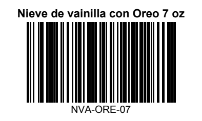
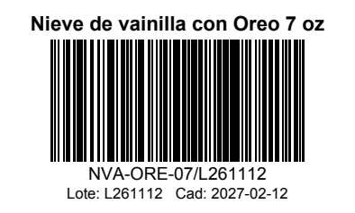
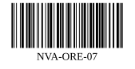

# Product Barcode Generator

A small command-line tool that reads a product list (CSV) and creates:

- a **barcode image** (PNG and SVG) for each product,
- a **printable label PDF** with barcode, SKU, product name and, when present, lot and expiry,
- a **manifest** (`manifest.csv`) linking each SKU to the exact value encoded and its files.

## Purpose

Creamio sells pre-packaged ice cream cups. A customer needs to identify each product
by barcode, and we want better inventory and batch tracking. The codes are for
**internal identification only**: they are not GS1-registered retail barcodes (see
[Limitations](#limitations)).

## Install

Requires Python 3.11 or newer.

```bash
python3 -m venv .venv
source .venv/bin/activate
pip install -e '.[dev]'          # or: pip install -e .   (without test tools)
```

## Usage

```bash
# Check the CSV without generating anything
python -m barcodegen validate products.csv

# Generate barcodes, labels.pdf and manifest.csv in ./output
python -m barcodegen generate products.csv --label-size 50x30
```

| Option | Default | Meaning |
|---|---|---|
| `-o, --output-dir` | `output` | Where files are written |
| `--label-size` | `50x30` | Label width x height in mm |
| `--page` | `label` | `label` = one label per PDF page (thermal label printers). `letter` / `a4` = grid of labels with cut guides, for office printers |
| `--printer-dpi` | `300` | Resolution of the label printer. Bar widths are snapped to whole printer dots so every bar prints the same width. Use `203` for 203 dpi printers, `0` to disable |
| `--dpi` | `600` | PNG resolution (minimum 300) |
| `--symbology` | `code128` | `code128` or `ean13` (see [EAN-13](#ean-13-extension-point)) |
| `--lot-separator` | `/` | Character placed between SKU and lot in the encoded value |
| `--gs1-prefix` | | GS1 company prefix, required for `ean13` |
| `--strict` | off | Exit with an error if there are warnings (e.g. bars too thin) |

Exit codes: `0` success, `1` invalid input (all problems are listed), `2` bad command-line arguments.

## Input format

CSV, UTF-8 (Excel's "CSV UTF-8" works; the BOM is handled). Header names are case-insensitive.

| Column | Required | Rules |
|---|---|---|
| `sku` | yes | Unique (case-insensitive, because it is also the file name). ASCII letters, digits, `-`, `_`, `.`; must start with a letter or digit |
| `name` | yes | Free text, accents allowed (`Nieve de yogurt griego con proteína 7 oz`) |
| `lot` | no | ASCII letters, digits, `-`, `_`, `.`. When present it is appended to the code: `NVA-ORE-07/L261112` |
| `expiry` | no | Free text, only printed on the label (`Cad: 2027-02-12`) |
| `item_ref` | no | Digits, only used by EAN-13 |

Example:

```csv
sku,name,lot,expiry
NVA-ORE-07,Nieve de vainilla con Oreo 7 oz,,
NVA-ORE-12,Nieve de vainilla con Oreo 12 oz,L261112,2027-02-12
```

Invalid input stops the run before anything is written and lists every problem with its line:

```
error: products.csv has 2 problem(s):
  - line 4: duplicate sku 'NVA-ORE-07' (first seen on line 2)
  - line 5: sku 'PROTEÍNA-07' has non-ASCII characters ('Í')
```

### SKU scheme used in `products.csv`

`products.csv` holds the current catalog (34 SKUs): `<LINE>-<FLAVOR>-<SIZE>`, size is `07` (7 oz) or `12` (12 oz).

| Line | Meaning | Flavors |
|---|---|---|
| `NVA` | Nieve de vainilla | `ORE` Oreo, `LOT` Lotus, `CAR` caramelo, `NUT` Nutella, `CHO` chocolate |
| `NCH` | Nieve de chocolate | `ORE` Oreo, `NUT` Nutella, `HER` Hershey's, `KIS` Mini Kisses |
| `NYP` | Nieve de yogurt griego con proteína | `FRU` y fruta, `NAT` sola, `AVE` y avena |
| `YGR` | Yogurt griego | `TAR` taro, `CAC` cacao |
| `HYG` | Helado de yogurt griego (7 oz only) | `MAN` mango, `FRE` fresa, `BLU` blueberry |
| `HGG` | Helado de yogurt griego con granola (12 oz only) | `MAN` mango, `FRE` fresa, `BLU` blueberry |

SKUs are kept short on purpose: on a 50 mm label, every extra character makes the bars
thinner. `NVA-ORE-07` prints with 0.25 mm bars; `CRM-NVA-ORE-07` would drop to 0.17 mm at
300 dpi, which is too thin to scan reliably on a curved cup. **Never reuse or change a SKU
once labels are printed**; add a new one instead.

## Output

```
output/
├── barcodes/
│   ├── NVA-ORE-07.png      # 600 dpi, DPI stored in the file
│   ├── NVA-ORE-07.svg      # vector
│   └── ...
├── labels.pdf              # one label per page (or a sheet with --page letter)
└── manifest.csv            # sku, name, lot, symbology, encoded_value, png_file, svg_file
```

Label (50x30 mm) without and with lot/expiry:

 

Barcode file (`output/barcodes/NVA-ORE-07.svg`):



Bars in the PDF are vector rectangles sized to whole printer dots, with a quiet zone of at
least 10 modules on each side. If a code is too long for the label (bars thinner than
0.19 mm or shorter than 8 mm) the tool prints a warning naming the SKU; `--strict` turns
that into a failure.

Files in `output/barcodes/` are overwritten on each run but never deleted; if you remove a
product from the CSV, delete its old images yourself. `manifest.csv` always reflects the last run.

## Printing tips

- **Use a thermal label printer** (direct thermal for short-life labels, thermal transfer
  with a resin or wax/resin ribbon if labels must survive condensation and handling).
  Print `labels.pdf` at **100 % / "actual size"**, never "fit to page".
- Set `--printer-dpi` to your printer's real resolution (203 or 300), so bars line up
  with the print head dots.
- Set the printer driver's media to the **same size as `--label-size`** and use the
  default `--page label`.
- Use **freezer-grade adhesive** labels (rated for application and use at −20 °C or
  lower). Standard adhesive peels off in the freezer.
- **Apply labels to cups at room temperature and dry**, before freezing. Labels applied
  to frosted or wet cups fall off.
- On small cups, apply the label rotated so the **bars are horizontal** and the code
  runs from rim to base ("ladder" orientation). The cup wall is straight in that
  direction, so the curve does not squeeze the bars at the ends of the code. Keep the
  label off seams and away from the base.
- Prefer **matte** labels: frost and gloss cause glare that confuses scanners.
- Test with your actual scanner on a frozen cup before printing a full batch.
- **Scanner keyboard layout:** USB scanners "type" the code like a keyboard. If the
  scanner is set to US layout and the computer to Spanish (Latin America), `-` and `/`
  can come out as other characters. Set both to the same layout.

## EAN-13 extension point

EAN-13 is built in but off by default. It is only for numbers licensed from GS1 México.
Add an `item_ref` column and pass your company prefix:

```bash
python -m barcodegen generate products.csv --symbology ean13 --gs1-prefix 7501234
```

GTIN = prefix + `item_ref` (zero-padded to 12 digits) + check digit (GS1 mod-10,
`barcodegen.symbology.ean13_check_digit`). EAN-13 holds digits only, so the lot is printed
as text but not encoded.

To add another symbology, subclass `Symbology` in [barcodegen/symbology.py](barcodegen/symbology.py)
and register it in `SYMBOLOGIES`.

## Development

```bash
pytest                         # unit tests
pip install zxing-cpp pypdfium2  # optional: enables tests/test_scan.py, which decodes
                                 # every generated PNG and PDF label with a real reader
```

Code layout:

| File | Role |
|---|---|
| `barcodegen/products.py` | CSV reading and validation |
| `barcodegen/symbology.py` | What gets encoded (Code 128, EAN-13) |
| `barcodegen/images.py` | PNG / SVG files |
| `barcodegen/labels.py` | Label PDF layout |
| `barcodegen/generate.py` | Pipeline and manifest |
| `barcodegen/cli.py` | Command line |

## Limitations

- **Not retail barcodes.** Code 128 values like `NVA-ORE-07` are not GTINs. Supermarket
  point-of-sale systems will not recognize them. Selling through retail chains needs
  GS1 registration (see EAN-13 above).
- **Lot makes codes long.** `SKU/LOT` on a 50x30 mm label gives bars below 0.19 mm and a
  warning. For lot tracking, use a wider label (e.g. 60x30 or larger) or short lot codes.
- **Expiry is text only**, not encoded in the barcode.
- No GS1-128 or DataMatrix with Application Identifiers (01, 10, 17) yet.
- The label PDF uses Helvetica: accented Spanish characters work, emoji and non-Latin
  scripts do not.
- One label per product per run; print several copies from the printer driver.
- No database or web interface: the CSV is the source of truth.

## Future ideas

- EAN-13 with the GS1 company prefix once licensed.
- GS1-128 / DataMatrix carrying GTIN, lot and expiry (AI 01, 10, 17).
- Integration with the Next.js pre-order app.
